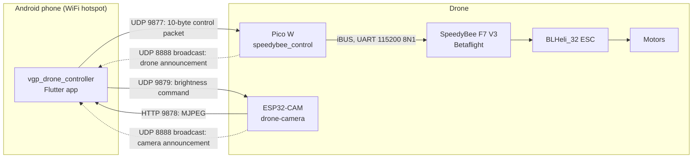

# Architecture

Describes the system as the code stands at the head of each submodule's
`master` branch (April 2025 for the firmware and app, March 2025 for the
camera).

## Components

| Component | Repository | Main file | Role |
|---|---|---|---|
| Controller app | `vgp_drone_controller` | `lib/control.dart` | Joysticks, arming, video, sends control packets |
| Receiver | `speedybee_control` | `picow_speedybee_control.c` | Receives control packets, emits iBUS |
| Camera | `drone-camera` | `drone-camera.ino` | MJPEG stream, flash LED |
| Flight controller | not in this project | Betaflight configuration | Stabilisation and motor output |

## Network

The phone's hotspot is the access point. The SSID and password are compiled
into both firmwares (`WIFI_SSID` / `WIFI_PASSWORD` in the Pico W source, `ssid`
/ `password` in the camera sketch) and are blank in the repositories.

### Ports

| Port | Transport | Listener | Purpose |
|---|---|---|---|
| 8888 | UDP broadcast | App | Discovery: `DRONE\|<ip>` and `CAMERA\|<ip>` |
| 9877 | UDP | Pico W | Phone acknowledgement, then control packets |
| 9878 | UDP | ESP32-CAM | Phone acknowledgement |
| 9878 | TCP (HTTP) | ESP32-CAM | MJPEG stream at `/` |
| 9879 | UDP | ESP32-CAM | `BRIGHTNESS\|<0-255>` |

### Discovery and startup

1. Pico W and camera join the hotspot.
2. Each broadcasts its announcement on UDP 8888. The Pico W repeats every 2 s
   until acknowledged. The camera sends it **once** (BACKLOG B-10).
3. The app, listening on 8888, replies `PHONE|<phone ip>` to the sender's
   address: port 9877 for the drone, 9878 for the camera.
4. On acknowledgement the Pico W switches its port-9877 handler from
   acknowledgement to control packets and starts the iBUS loop on core 1. The
   camera starts its HTTP server.
5. When the app has seen both devices it waits 1 s and opens the control
   screen. It does not proceed with only one device.

The phone IP carried in the acknowledgement is stored by both devices but not
used afterwards. The app finds its own IP by picking the first interface
address starting with `192.168.`.

## Control packet (app to Pico W)

UDP, exactly 10 bytes, five little-endian `uint16` values. Any other length is
dropped.

| Offset | Channel | Range | Notes |
|---|---|---|---|
| 0 | Roll | 1000 to 2000 | Left stick X, centre 1500 |
| 2 | Pitch | 1000 to 2000 | Left stick Y inverted, centre 1500 |
| 4 | Throttle | 850 to 2000 | Starts at 855; changed incrementally by right stick Y |
| 6 | Yaw | 1000 to 2000 | Right stick X, centre 1500 |
| 8 | AUX1 | 1200 or 1500 | 1200 disarmed, 1500 armed |

The packet is copied over the first five entries of the Pico W's 14-channel
array. There is no sequence number, checksum, or sender check.

**Send rate.** The app sends only from joystick callbacks and the arm toggle.
While a stick is held the joystick widget calls back periodically (the
`flutter_joystick` default period, about 100 ms); when nothing is touched,
nothing is sent.

**Throttle** is not a spring-centred axis. Each right-stick callback adds
`-y * 10` to the stored value, so full deflection changes throttle by about 10
units per callback. Releasing the stick holds the current throttle.

## iBUS output (Pico W to flight controller)

| Property | Value |
|---|---|
| UART | `uart1`, TX on GP4 (GP5 is defined as RX but never configured) |
| Format | 115200 baud, 8N1 |
| Rate | 7 ms sleep per loop: nominally 143 Hz, lower in practice because each frame is also printed over stdio |

Frame, 32 bytes:

| Bytes | Content |
|---|---|
| 0 | `0x20` |
| 1 | `0x2C` (standard iBUS uses `0x40`; see B-13) |
| 2 to 29 | 14 channels, `uint16` little-endian |
| 30 to 31 | Checksum: `0xFFFF` minus the sum of bytes 0 to 29, little-endian |

Channels 1 to 5 come from the control packet. Channels 6 to 14 are fixed at
1500. Channel order is AETR, with arming on channel 5.

## Pico W execution model

| Core | Work |
|---|---|
| 0 | WiFi bring-up, discovery, then idle. lwIP callbacks (`pico_cyw43_arch_lwip_threadsafe_background`) write `current_channels` |
| 1 | Every 7 ms: check link status, copy `current_channels`, send an iBUS frame |

The shared array is guarded with `save_and_disable_interrupts`, which masks
interrupts on the calling core only and so does not exclude the other core
(B-07).

**Failsafe as implemented.** When `cyw43_wifi_link_status` stops reporting
`CYW43_LINK_JOIN`, core 1 writes a failsafe frame once (sticks centred,
throttle 855, AUX1 1500) and then stops sending until the link returns. AUX1
1500 is the armed value (B-02). Nothing detects packets stopping while WiFi
stays associated (B-01).

## App structure

| File | Responsibility |
|---|---|
| `lib/main.dart` | App entry, dark theme, portrait lock |
| `lib/splash.dart` | Splash screen |
| `lib/connection.dart` | Hotspot reminder, discovery, acknowledgements |
| `lib/control.dart` | Channel state, UDP sender, landscape control screen |
| `lib/widgets/dual_joystick.dart` | Stick-to-channel mapping; ignores input when disarmed |
| `lib/widgets/settings_menu.dart` | Reload camera, Quit, ARM switch |
| `lib/widgets/camera_feed.dart` | MJPEG view with reload on error |
| `lib/widgets/brightness_control.dart` | Flash LED slider |
| `lib/widgets/channel_value_overlay.dart`, `channel_value_bar.dart` | Channel read-out |
| `lib/widgets/device_status_box.dart` | Connection screen status tiles |

Dependencies: `flutter_joystick ^0.2.1`, `udp ^5.0.3`, `flutter_mjpeg ^2.0.4`.

## Camera

AI Thinker pin map. UXGA at JPEG quality 10 with two frame buffers when PSRAM
is present, otherwise SVGA at quality 12. The flash LED on GPIO4 is driven by
8-bit PWM at 5 kHz. The brownout detector is disabled at boot. The main loop
only polls for brightness packets; the HTTP server task serves the stream.
